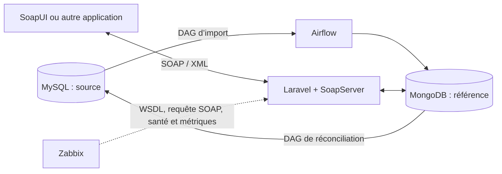

# Service SOAP de clients — Groupe 5 SI

Projet **Développement à base de composants et services web**, IBAM, 2026.
Exercice 7 : Laravel, Airflow, MySQL, MongoDB et Zabbix.

## Membres

| Nom | Prénoms |
|---|---|
| SANKARA | Michail Alioun Juste |
| KOANDA | GILDAS |
| BARRY | EL NOUR |
| CONGO | Bénéré Nelson Cephas |
| KONE | Assita |

Répartition renseignée par le groupe dans la présentation :

| Membre | Partie |
|---|---|
| KOANDA GILDAS | Infrastructure Docker, dépôt Git et README |
| SANKARA Michail Alioun Juste | MySQL, jeu de données et DAG d’import |
| BARRY EL NOUR | Service SOAP Laravel, WSDL et validation |
| CONGO Bénéré Nelson Cephas | MongoDB, DAG de réconciliation |
| KONE Assita | Zabbix, tests SoapUI et documentation |

## Objectif et architecture

Les [spécifications](docs/SPECIFICATIONS.md) relient les exigences de l’exercice
aux choix techniques et aux critères de réception.

Le service permet de consulter, rechercher et modifier des clients fictifs.
MySQL fournit les données initiales ; Airflow les contrôle et les charge dans
MongoDB. **MongoDB est la base de référence du service SOAP.** Un second DAG
renvoie les modifications SOAP vers MySQL. Zabbix surveille l’ensemble.



| Exigence | Réalisation |
|---|---|
| Clients MySQL | Schéma et 208 lignes fictives : 201 valides, 7 volontairement invalides |
| Chargement Airflow | Extraction, validation, normalisation, chargement sans doublon et rejets tracés |
| SOAP Laravel | Les trois opérations demandées ; WSDL 1.1 / SOAP 1.1 |
| Documentation du contrat | [Paramètres, réponses, validations et Faults](docs/DOCUMENTATION_SOAP.md) |
| Référence MongoDB | Toutes les opérations SOAP utilisent MongoDB |
| Supervision et tests | Modèle Zabbix, tests automatisés et requêtes SoapUI |
| Retour vers MySQL | DAG de réconciliation et [stratégie documentée](docs/RECONCILIATION.md) |

## Installation locale

Prérequis : Git, Docker Engine démarré, Docker Compose v2 et Python 3.10 ou plus.
Prévoir une machine avec **8 Go de RAM au minimum**, dont environ **6 Go
disponibles** pour l’ensemble des services, et environ **10 Go de disque** pour
les images et les données initiales. Ce sont des estimations de préparation,
pas des mesures de consommation garanties. Le premier téléchargement peut être long.

```sh
git clone --branch main https://github.com/gildaskoanda/soap-clients-groupe5-si.git
cd soap-clients-groupe5-si
python3 scripts/prepare_env.py
docker compose config --quiet
docker compose build
docker compose up -d
docker compose ps
```

Le script crée `.env` avec des secrets aléatoires et préserve une configuration
existante. Ce fichier est exclu de Git. Le démarrage initialise les bases vides
et les métadonnées Airflow ; aucune migration Laravel n’est nécessaire pour les
clients. Attendre que les services soient prêts avant de lancer les tests.

| Service | Adresse locale | Accès |
|---|---|---|
| Accueil Laravel | http://localhost:8080 | Page d’accueil du framework |
| WSDL | http://localhost:8080/soap/clients?wsdl | Contrat XML |
| Santé Laravel + MongoDB | http://localhost:8080/health | `status=ok`, `mongodb=up` |
| Airflow | http://localhost:8081 | Identifiants définis dans `.env` |
| Zabbix | http://localhost:8082 | Initialement `Admin` / `zabbix` |
| MySQL | `127.0.0.1:3307` | Identifiants de `.env` |
| MongoDB | `127.0.0.1:27018` | Identifiants de `.env` |

Entre conteneurs, les noms d’hôte sont `mysql`, `mongo`, `laravel`, etc.
Tous les ports publiés sont limités à la machine locale.

### Charger les clients et configurer Zabbix

```sh
docker compose exec airflow-scheduler airflow dags trigger clients_mysql_to_mongo
python3 zabbix/setup_zabbix.py
```

Suivre l’import dans Airflow jusqu’à `success`. Sur des bases neuves, attendre
**201 clients et 7 rejets** dans MongoDB. La découverte initiale des DAG peut
prendre quelques minutes. Le [guide Zabbix](docs/SUPERVISION_ZABBIX.md) explique
les métriques, les seuils et la démonstration de panne.

Lors du premier démarrage, Zabbix doit créer sa base : cette étape peut prendre
plusieurs minutes. Le script de configuration attend automatiquement l’API
pendant dix minutes au maximum. Si des conteneurs restent à l’état `Created`
après une interruption, relancer `docker compose up -d`, puis contrôler
`docker compose ps -a`. Une attente dépassée doit être diagnostiquée avant de
relancer la configuration ; elle ne justifie pas de supprimer les volumes.

### Arrêter et reprendre

```sh
docker compose stop
docker compose start
```

Les volumes conservent les données. `docker compose down` retire les conteneurs
et le réseau mais conserve les volumes. Ne pas ajouter `-v` pour un simple
redémarrage : cette option supprime les données du projet.

Après une modification de Laravel : `docker compose up -d --build laravel`.
Les DAG sont montés directement depuis `airflow/dags`.

## Tests et preuves

Le [plan de tests](docs/TESTS.md) précise les prérequis et les résultats attendus.
Les [résultats de validation](docs/RESULTATS_VALIDATION.md) distinguent les tests
sur bases simulées des tests sur services réels.

```sh
# Tests Python isolés
python3 -m venv .venv
.venv/bin/python -m pip install -r airflow/requirements-dev.txt
.venv/bin/python -m pytest airflow/tests -v --cov=airflow/dags/clients_etl

# SOAP : arrête puis redémarre MongoDB pour vérifier la panne
python3 tests/e2e/run_soap_tests.py --db-down docker --report docs/RESULTATS_TESTS_DOCKER.md

# Chaîne complète : nécessite Bash, Python 3, curl et les services démarrés
bash tests/e2e/run_pipeline_e2e.sh

# Supervision réelle : collecte, panne MongoDB, alerte et rétablissement
python3 tests/e2e/run_zabbix_tests.py --simulate-outage
```

Ces tests modifient des fiches fictives : utiliser l’environnement de démonstration.
Les tests de panne doivent être exécutés successivement, jamais en parallèle.
Sous Windows, utiliser WSL ou Git Bash pour le scénario shell et
`.venv\Scripts\python.exe` pour l’environnement Python natif.

## Organisation

| Dossier | Contenu |
|---|---|
| `airflow/` | Deux DAG, traitements et tests Python |
| `db/` | Schéma MySQL, données fictives et initialisation MongoDB |
| `docker/` | Image PHP / Apache |
| `laravel-app/` | Application Laravel, service SOAP et WSDL |
| `zabbix/` | Modèle et script de configuration |
| `tests/` | Tests SOAP, chaîne complète et requêtes SoapUI |
| `docs/` | Contrat, réconciliation, supervision, tests et démonstration |
| `presentation/` | Présentation PowerPoint |
| `scripts/` | Préparation de l’environnement et outils de livraison |

## Choix et limites

Une fiche modifiée par SOAP reste gérée par MongoDB après réconciliation :
un ancien lot MySQL ne peut pas la réécraser. Le retour MySQL est différé et
les deux bases ne partagent pas de transaction.

Le service ne propose ni création ni suppression de clients. Cette démonstration
locale utilise des données fictives, sans authentification SOAP ni terminaison
HTTPS. Les versions majeures de l’environnement d’origine sont conservées ;
une mise en production demanderait une étude de support et de sécurité.

## Dépannage

| Symptôme | Vérification |
|---|---|
| Docker inaccessible | Démarrer Docker Engine / Docker Desktop |
| Port occupé | Libérer le port ou adapter son mapping et les URL des tests |
| DAG absent | Attendre son analyse ; vérifier `airflow dags list-import-errors` |
| Fault `SERVICE_UNAVAILABLE` | Vérifier MongoDB et la cohérence des identifiants |
| Mot de passe changé sans effet | Modifier `.env` ne modifie pas un compte déjà créé dans une base |
| Import Zabbix refusé | Lire le message du script et utiliser Zabbix 7.0 |

## Présentation et remise

Le [guide de démonstration](docs/GUIDE_DEMONSTRATION.md) fournit le scénario.
Le [PowerPoint](presentation/PRESENTATION_SOAP_CLIENTS.pptx) présente le groupe,
l’architecture et les éléments à démontrer.

Après relecture et publication par le groupe, transmettre le lien du dépôt public
selon les consignes de l’enseignant. Un lien `localhost` désigne la machine de
celui qui l’ouvre et ne donne pas accès à celle du groupe.

Cette livraison est préparée sur `main`. Si `master` reste la branche par défaut
du dépôt, partager le lien de la branche `main` pour montrer cette version.

Le [document Word](docs/DOCUMENTATION_SOAP.docx) ajouté par le groupe est conservé.
Il correspond à la rédaction antérieure ; pour le contrat à jour, utiliser la
[documentation Markdown](docs/DOCUMENTATION_SOAP.md) et le WSDL.

## Annexe : scripts Python via Docker

Si Python n’est pas installé sur la machine de démonstration, les scripts de
configuration Zabbix et de tests SOAP peuvent utiliser un conteneur Python.
Ces commandes supposent que `.env` a déjà été préparé et que la pile est démarrée.

Sous **Git Bash / Windows** :

```sh
MSYS_NO_PATHCONV=1 docker run --rm -v "$(pwd -W):/w" -w /w \
  -e ZABBIX_URL=http://host.docker.internal:8082/api_jsonrpc.php \
  python:3.12-slim python zabbix/setup_zabbix.py

MSYS_NO_PATHCONV=1 docker run --rm -v "$(pwd -W):/w" -w /w python:3.12-slim \
  python tests/e2e/run_soap_tests.py --url http://host.docker.internal:8080 --db-down skip
```

Sous **Linux / macOS**, remplacer `$(pwd -W)` par `$(pwd)` et retirer
`MSYS_NO_PATHCONV=1`. Sous Linux, ajouter également
`--add-host=host.docker.internal:host-gateway` après `docker run --rm`.
Ces variantes Windows/macOS sont des indications, pas des plateformes validées.

Ce mode SOAP exécute **21 tests** : le conteneur Python n’a pas accès au client
Docker, donc les deux tests de panne/reprise sont exclus. Pour la recette complète,
suivre [le plan de tests](docs/TESTS.md) : **23 tests SOAP, 27 contrôles de chaîne
complète et 9 contrôles Zabbix**, avec les pannes exécutées successivement.
